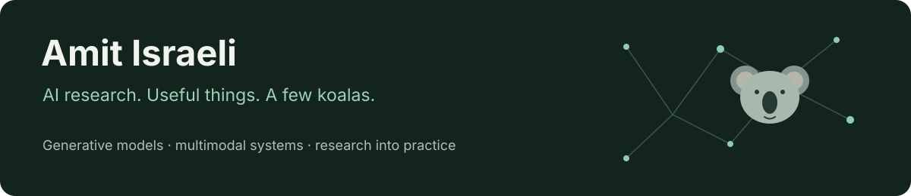

I'm an **AI Research Scientist at Wix**, working on generative AI and multimodal models. I like taking an idea from a paper through training, evaluation, and a working product—and making room for a little personality along the way.

[Website & demos](https://amit154154.github.io/) · [Hugging Face](https://huggingface.co/AmitIsraeli) · [LinkedIn](https://www.linkedin.com/in/amit-israeli-aa4a30242/) · [Email](mailto:amit1541541@gmail.com)

## Research I'm exploring

Diffusion and generative image/video models, efficient adaptation and post-training, vision-language systems, and small models that do something useful.

| Project | What I'm exploring |
| --- | --- |
| [HyperscaleES · text-to-image](https://github.com/amit154154/HyperscaleES_T2I) | Low-rank Evolution Strategies for LoRA post-training with black-box preference rewards. An unofficial adaptation of EGGROLL to a different domain. |
| [Sana Simplified](https://github.com/amit154154/Sana-Simplified) | Image conditioning, ControlNet and SigLIP-driven zoom control with Sana. |
| [SANA-Video · Tom & Jerry LoRA](https://huggingface.co/AmitIsraeli/sanavideo-tomjerry-lora-r16-v1) | Video adaptation and scene-aware conditioning on a single consumer GPU. |
| [Maple LLM](https://amit154154.github.io/#featured) | A small vision-language policy learning to play MapleStory from my gameplay. Demo and method on my site. |
| [Kokoro experiments](https://github.com/amit154154/kokoro_jarvis) | Voice mixing, embedding optimization and visual tools for compact TTS. |

More experiments: [token-budget-aware VLM reasoning](https://github.com/amit154154/Token_Budget_cot_VLM), [few-shot SAM + LoRA](https://github.com/amit154154/SAM_LORA), [PopYou / VAR](https://github.com/amit154154/VAR_clip), and [MusicGen fine-tuning](https://github.com/amit154154/musicgen_finetune).

## Things I built for everyday life 🐨

<table>
<tr><td width="50%" valign="top">

### [Koala Mini Keyboard](https://github.com/amit154154/koala-controls/blob/main/docs/MINI-KEYBOARD.md)

A tiny USB pad, MacBook shortcuts and an iPhone remote for workspaces, media and window movement—with illustrated guides, koala reactions and local mastery levels.

</td><td width="50%" valign="top">

### [Koala TV](https://github.com/amit154154/koala-controls/blob/main/docs/KOALA-TV.md)

A couch-friendly home for a Mac connected to a TV: resume media, share a screen, control playback and audio from an old iPhone. Shares the Koala Controls engine.

</td></tr>
</table>

Also: [KoalaSwimShokz](https://github.com/amit154154/KoalaSwimShokz), a native Mac app for swim-headphone playlists; [KoalaReadingPapers](https://github.com/amit154154/KoalaReadingPapers), papers turned into audio; and the [interactive playground on my site](https://amit154154.github.io/#playground), including a tiny LLM running in the browser.

## Where I've worked

| When | Where | Focus |
| --- | --- | --- |
| Mar 2026–present | **Wix · AI Research Scientist** | Generative AI and multimodal research |
| Jan 2025–Jan 2026 | Reality Defender · Computer Vision Research Engineer | Deepfake and synthetic-media detection |
| Dec 2024–Apr 2025 | LuckyLab · Freelance Computer Vision Research Engineer | Edge segmentation and detection |
| Jun 2024–Jan 2025 | NLPearl · Deep Learning Research Engineer | Small language models, audio and real-time conversational systems |
| May 2023–Jun 2024 | Pashoot Robotics · Computer Vision & Deep Learning Research Engineer | Few-shot vision, pose estimation, reconstruction and simulation |

For project demos, research notes, models and the full story, visit **[amit154154.github.io](https://amit154154.github.io/)**. Open to interesting research collaborations and side projects.
